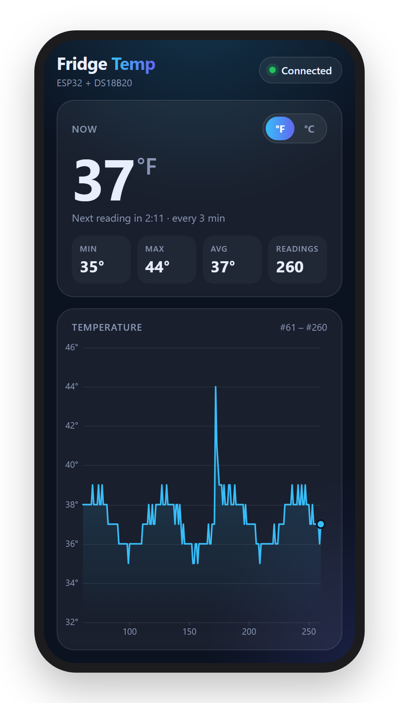
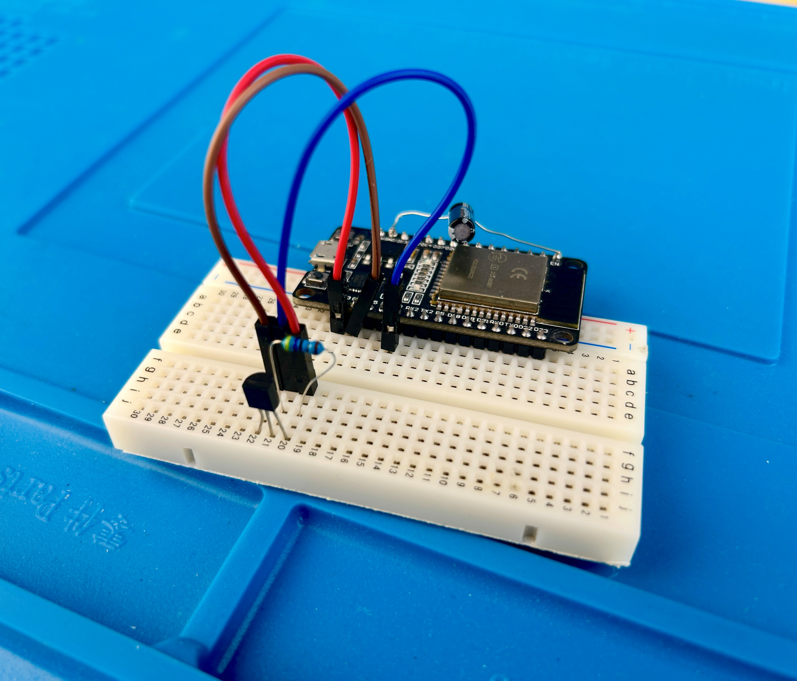
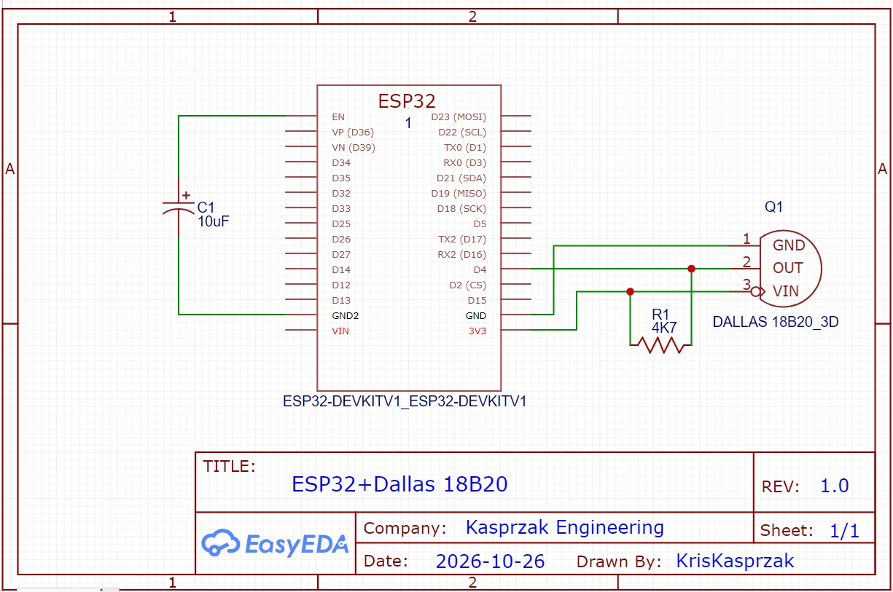

# Remote Temperature Monitor: ESP32 Refrigerator Logger You Watch From Your Phone

Keep an eye on the temperature in your refrigerator from your phone. An ESP32 reads a
**Dallas DS18B20** sensor every 3 minutes, stores the readings, and serves a web page on your
home WiFi that plots them live. There's no app to install and no cloud service. Just open the
ESP32's IP address in your phone's browser.

You Tube Link https://youtu.be/39rNiztudXI



---

## Features

- **Live plot on your phone.** Reading number on the x axis, temperature on the y axis.
  The plot holds 200 points. After that it scrolls so the newest reading is always at the right edge.
- **Full history on connect.** When the page opens it loads every reading the ESP32 has saved
  (up to 48 hours). After that it only fetches the newest reading.
- **°F / °C switch.** The ESP32 records in °F. The phone converts for display and remembers your choice.
- **At-a-glance stats.** Current temperature, min, max, average, reading count, and a countdown
  to the next reading.
- **Touch the plot** to see the exact value and reading number at any point.
- **Self-healing.** If your phone sleeps and misses readings, or the ESP32 restarts, the page
  reloads the full history automatically. If the WiFi drops, the ESP32 reconnects and keeps
  recording in the meantime.
- **Single sketch.** The whole web page (HTML, CSS and JavaScript) lives in `TempPage.h`.
  Nothing else needs to be uploaded to the ESP32.

## Hardware

| Part | Notes |
|---|---|
| ESP32 DevKit V1 | Any classic ESP32 dev board |
| DS18B20 temperature sensor | TO-92 or the waterproof probe. The probe's thin cable fits under a refrigerator door seal |
| 4.7 kΩ resistor | Pull-up from the sensor DATA line to 3.3 V (required for the 1-Wire bus) |
| 10 µF capacitor | Between EN and GND, fixes auto-reset problems when programming over USB |
| Breadboard + jumpers | Or solder it all once it works |



## Wiring



| DS18B20 pin | ESP32 |
|---|---|
| GND | GND |
| DATA (OUT) | GPIO 4, **plus a 4.7 kΩ resistor from DATA to 3.3 V** |
| VDD (VIN) | 3.3 V |

The 10 µF capacitor goes between **EN** and **GND** (+ side to EN).

## Software Setup

### Libraries

Install both from the Arduino Library Manager:

- [OneWire](https://github.com/PaulStoffregen/OneWire)
- [DallasTemperature](https://github.com/milesburton/Arduino-Temperature-Control-Library)

`WiFi` and `WebServer` come with the ESP32 board package.

### Board settings

| Setting | Value |
|---|---|
| Board | ESP32 Dev Module |
| Upload speed | 921600 |
| CPU frequency | 240 MHz |
| Partition scheme | Default |

### Configure and upload

1. Arduino needs the sketch folder to have the same name as the `.ino` file. Put
   `RemoteTempSensor.ino` and `TempPage.h` in a folder called `RemoteTempSensor`.
2. Enter your WiFi network name and password at the top of `RemoteTempSensor.ino`:
   ```cpp
   #define WIFI_SSID "your-network"
   #define WIFI_PASS "your-password"
   ```
3. Upload, then open the Serial Monitor at **115200** baud. The ESP32 prints its address:
   ```
   Connected, open http://192.168.1.42
   ```
4. Open that address in your phone's browser. Your phone must be on the same WiFi network.

> **Tip:** Give the ESP32 a reserved (static) IP address in your router so the address never
> changes, then bookmark it or use *Share → Add to Home Screen* in Safari to open it like an app.

### Options

These are at the top of `RemoteTempSensor.ino`:

| Setting | Default | What it does |
|---|---|---|
| `PIN_SENSOR` | `4` | GPIO the DS18B20 DATA line is connected to |
| `USE_FAHRENHEIT` | `true` | Units the ESP32 records in (the phone can display either) |
| `READ_INTERVAL` | `180000` | Milliseconds between readings (3 minutes) |
| `MAX_READINGS` | `960` | Readings kept on the ESP32 (960 × 3 min = 48 hours). Each reading uses 2 bytes, so this can go much higher |

At the top of the `<script>` section of `TempPage.h`:

| Setting | Default | What it does |
|---|---|---|
| `PLOT_POINTS` | `200` | Points shown on the plot before it starts scrolling |
| `POLL_MS` | `5000` | How often the phone checks for a new reading |

## How It Works

The ESP32 stores readings in a ring buffer of whole numbers. Each reading gets a sequence number
(1, 2, 3...) that the page uses for the x axis. No clock or time sync is needed.

The page talks to the ESP32 with JavaScript `fetch()` (AJAX) and small JSON replies:

| Request | When | ESP32 reply |
|---|---|---|
| `/` | Page load | The web page from `TempPage.h` |
| `/all` | Once, when the page opens | `{"u":"F","i":180,"s":95,"n":1234,"t":[38,37,38,...]}` |
| `/latest` | Every 5 seconds | `{"u":"F","i":180,"s":95,"n":1234,"t":38}` |

`u` = units, `i` = seconds between readings, `s` = seconds until the next reading,
`n` = sequence number of the latest reading, `t` = temperature(s).

If `/latest` returns a number exactly one higher than the page's last reading, the point is
added to the plot. If there's a gap (the phone was asleep) or the number went backwards
(the ESP32 restarted), the page asks for `/all` again. `/all` is sent in chunks, so the
ESP32 never builds one large string in memory.

## Troubleshooting

| Problem | Fix |
|---|---|
| Serial Monitor shows `No DS18B20 found` | Check the wiring and that the 4.7 kΩ pull-up is in place |
| `Sensor read failed, reading skipped` | Loose connection or a missing pull-up. Failed reads are skipped, not stored |
| Reads 185 °F (85 °C) | The DS18B20 power-on value. Usually a power or wiring problem |
| Phone can't open the page | Make sure the phone is on the same WiFi (not cellular) and the IP address matches the Serial Monitor |
| Status shows **No link** | The ESP32 hasn't answered for 15 seconds. Check that it's powered and in WiFi range |
| Upload fails with a connection or timeout error | Add the 10 µF capacitor between EN and GND, or hold BOOT while uploading |

## License

MIT. See [LICENSE](LICENSE).
